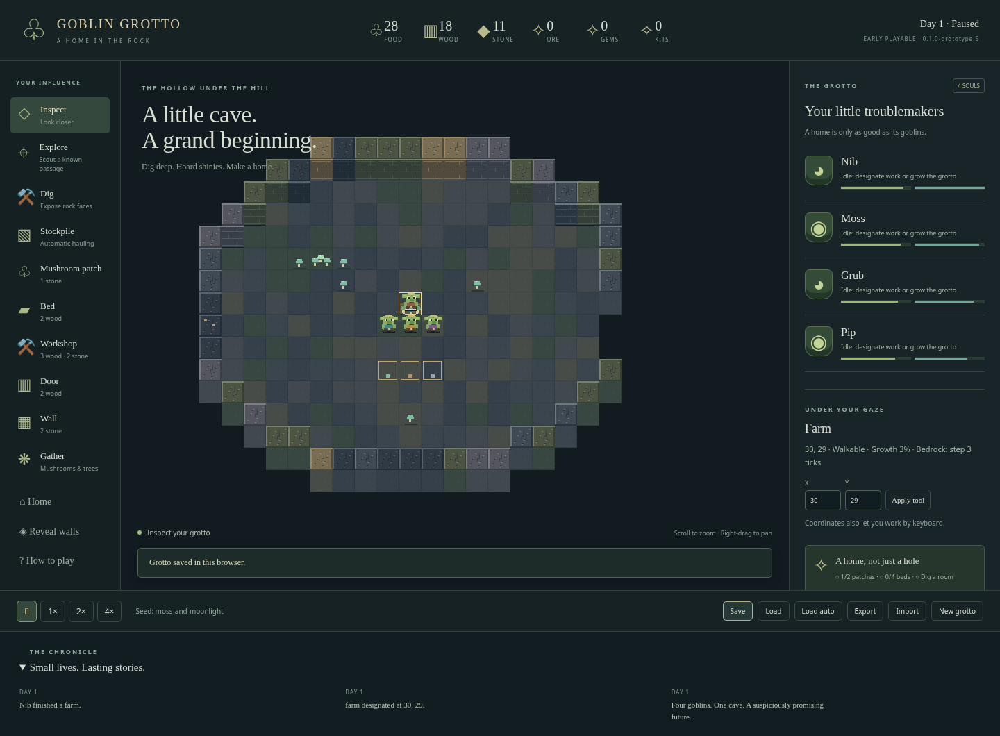

# 🍄 Goblin Grotto

> **Dig deep. Hoard shinies. Cause trouble.**

A browser-first, dark-fairy-tale colony simulator and dungeon-defence game.
You are the **Spirit of the Grotto**, guiding eccentric goblins as they make a
home beneath the hill. The Brothers Grimm meet slapstick.

## Play the prototype

**Current build: `0.1.0-prototype.5`**, an early local playable colony slice.
This is not the completed v0.1 milestone or a public release.

A [private hosted preview](https://goblin-grotto-prototype.breezyeft133.chatgpt.site) is available to the owner through ChatGPT sign-in.

To run locally, use Node 24:

```sh
npm ci
npm run dev
```

Open the URL printed by Vite (normally `http://localhost:5173`). A desktop browser
with WebGL enabled is required. The game uses no backend or remote art services.



Four named goblins—Nib, Moss, Grub and Pip—autonomously dig, haul, build,
gather, eat and sleep. The seeded 64×64 world has connected chambers, an entrance,
a small outdoor strip, hidden chambers, mushrooms, trees and distinct ore veins. Designate work and let them do it.

### Explore the new world

Start **New grotto** to see the new generation rules. Existing saves retain their
original layouts and knowledge. Choose **Explore** and click a turquoise frontier
dot on a known passage: a goblin walks there and reveals more. Digging can open
sealed chambers. Inspect groves, ruins, old workings, pools, shrines and dens for
local stories and resources. Pools block movement; known terrain stays remembered.

Mine coloured iron, copper, gold and gem deposits. Gather trees, edible mushrooms,
loose stone and ancient masonry. The ore counter's tooltip breaks down the metals;
gems have their own total. Distant, unseen landmarks do not appear in the inspector.

### Your first home

1. Select **Mushroom patch** and place two on empty cavern floor (one stone each).
   Mushrooms grow and are harvested automatically; food is hauled and eaten.
2. Build **beds** (two wood each). Goblins can sleep on the floor in the meantime.
3. Select **Dig** and click the exposed rock around the cave. Harder materials
   take longer. Newly excavated tiles reveal their neighbours and drop resources.
4. Mark a **stockpile** on empty floor to collect loose supplies automatically.
5. **Gather** trees outside or wild mushrooms. Build a **workshop**, then select
   **Craft** on it: one stored wood becomes a physical bed kit, automatically used
   before raw wood when constructing a bed.
6. **Save** in this browser or **Export** a portable JSON backup.

Gold outlines show excavation; teal outlines show other planned work. Select a
tile to inspect its progress or failure reason. Hungry and tired goblins interrupt
work to look after themselves. The sidebar tracks food and energy.

### Controls and saves

- Left-click: inspect goblins, tiles and structures, or apply the selected tool.
  Hold and drag to paint work; each tile is affected once per stroke. Coordinate inputs provide
  a keyboard alternative. Cancel work releases reservations and refunds construction.
- Right-drag / arrow keys: pan. Scroll / `+` / `−`: zoom. **Home**: reset the view. Zoom follows the pointer; the camera stays within map bounds.
- **Reveal walls** fades foreground obstacles so hidden goblins can be selected.
  Selecting a goblin follows their location in the inspector; the Chronicle opens
  and closes as a keyboard-accessible drawer.
- **Space**: pause/resume. Speed buttons: pause, 1×, 2×, 4×. **Escape**: inspect mode.
- **How to play** opens the guide. Simulation pauses in dialogs and hidden tabs.
- **Save / Load** use a manual IndexedDB slot. Every 30 seconds, a separate autosave
  is written; **Load auto** restores it. Export before clearing browser data.
- **Import** validates a version-1 or version-2 save before replacing the current game. Future
  or damaged saves show a message and leave the current grotto intact.
- **New grotto** asks for a seed and replaces the active session; save first.

### Prototype boundaries

This slice demonstrates the home-building loop. It has temporary original
original pixel sprites, modest animation and simple pathfinding. It does **not**
yet implement Souls, Chief/Shaman politics, possession, inventory equipment,
combat, raids, generations, weather, cave-ins or the Overlord. Actor congestion, smooth movement, camera polish and the production art pipeline
still need work.
There is no starvation death or combat failure state yet. Workshop content is one
small recipe; a full economy is later work.

The ambitious design remains in [PLAN.md](PLAN.md). Task checkboxes reflect tested
acceptance criteria; partial implementations remain unchecked. See
[prototype verification and remaining work](docs/PROTOTYPE.md).

## Pixel-art scale

The native grid is 32×32. Home restores 1× zoom: one tile occupies 32×32 screen
pixels. Floors, wall tops, wall sides, each goblin and all plants have separate
32×32 PNGs; walls assemble a raised top and a separate exposed front face. Zoom
magnifies the scene with nearest-neighbour sampling.

See the [individual art preview](https://goblin-grotto-prototype.breezyeft133.chatgpt.site/art-preview.html).
The original 29-file set is listed in `public/assets/prototype/manifest.json` and
reproduced with `node tools/generate-pixel-art.mjs`. Production animation and atlas
work remain later tasks.

## Where the game is heading

Goblins will have compact **Souls**—Four Humours, ambitions, memories and
relationships. Policies and leaders guide their choices; possession lets the
Spirit intervene at a personal and political cost. Goblins defeat stronger foes
through traps, morale, tunnels and scavenged equipment. Named treasures carry
histories and ancestral claims, activated by what factions actually learn.
Generations inherit those stories. Defeating the Overlord is optional; the grotto
continues afterwards. One playable Z-level and an abstract wider world keep v1
bounded and focused on what goblins can experience.

## Development

Mud and loose ground slow movement; the terrain inspector shows movement, digging
and support properties. Support ratings anticipate cave-ins, which are still future work.

Strict TypeScript + Vite, PixiJS WebGL with a fixed three-quarter JRPG view, semantic HTML/CSS, a pure 10 Hz simulation,
seeded serializable RNG, typed commands/events, and versioned IndexedDB saves.
Rendering never decides gameplay outcomes.

```sh
npm run typecheck
npm run lint
npm run format:check
npm test
npm run build
npx playwright install chromium
npm run test:browser
```

Browser tests also work with `/usr/bin/chromium` when installed. Tests cover
replay, projection, seed reachability, colony endurance, construction refunds,
item transfers, save continuation and real browser interactions. `npm run preview`
serves the production build. [AGENTS.md](AGENTS.md) and
[contribution guidance](docs/CONTRIBUTING.md) describe the workflow.

## Licences

Source and technical documentation: [MIT](LICENSE.md), © 2026 Mark Baldwin-Smith.
Creative assets: [separate rights notice](ASSETS-LICENSE.md). Original creative
assets are not automatically MIT-licensed. Prototype sprites were generated from original integer-pixel drawings
for this project; no third-party game graphics, fonts or audio were imported.
