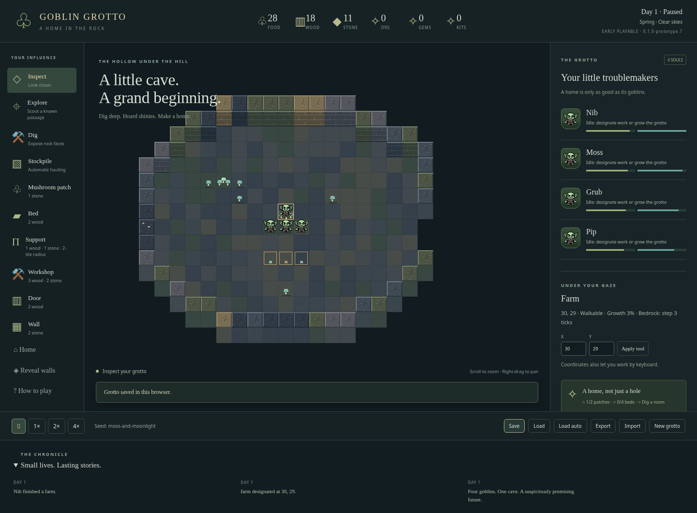

<div align="center">


# 🍄 Goblin Grotto

**Dig deep. Hoard shinies. Cause trouble.**

*A little cave. A grand beginning.*

[](https://github.com/mbaldwinsmith/goblin-grotto/actions/workflows/quality.yml)
[](CHANGELOG.md)
[](LICENSE.md)
[](ASSETS-LICENSE.md)

[](https://nodejs.org/)
[](tsconfig.json)
[](package.json)

[**Play the private preview**](https://goblin-grotto-prototype.breezyeft133.chatgpt.site/) · [**Run locally**](#run-locally) · [**Controls**](#controls-and-saves) · [**Roadmap**](PLAN.md)

</div>

---

You are the **Spirit of the Grotto**, guiding four eccentric goblins as they carve
out a home beneath the hill. Grow mushrooms, gather supplies, shore up loose
ceilings and watch your little troublemakers get on with the work.

Goblin Grotto is a browser-first, dark-fairy-tale colony simulator and
dungeon-defence game in development. **The Brothers Grimm meet slapstick.**



> **Early playable · `0.1.0-prototype.16`**<br>
> The home-building loop is playable. This is an early prototype; the full v0.1
> milestone is still open. The hosted preview is private and requires the owner's
> ChatGPT sign-in. You can also run the game locally.

## A home worth digging for

| | In the current prototype |
| --- | --- |
| **👺 Four little troublemakers** | Nib, Moss, Grub and Pip dig, haul, build, gather, eat and sleep autonomously. Their identities and facing persist through saves. |
| **⛏️ A grotto to discover** | Seeded 64×64 caves, hidden chambers, a small outdoor region, trees, fungi and iron, copper, gold and gem deposits. |
| **🍄 A working little colony** | Mushroom farms, beds, filtered stockpiles, workshops and bed-kit crafting. Priorities and preferred work guide the goblins. |
| **🪵 A roof to keep up** | Warned cave-ins, buildable supports, seasonal weather and routes that account for terrain and travel costs. |
| **🎨 A proper JRPG view** | Fixed three-quarter perspective, a 48×48 display grid, separate wall tops and sides, and four-direction goblin animations. |
| **💾 A home to return to** | Manual saves, separate autosaves and portable JSON export/import, including migration of older colonies. |

## Run locally

You need **Node.js 24+**, npm and a desktop browser with **WebGL** enabled.
The game runs entirely in your browser; gameplay needs no backend or remote art service.

```sh
git clone https://github.com/mbaldwinsmith/goblin-grotto.git
cd goblin-grotto
npm ci
npm run dev
```

Open the address printed by Vite, normally **http://localhost:5173**.
For a production build, run `npm run build`, then `npm run preview`.

## Your first home

1. **Grow dinner.** Place two **Mushroom patches** on empty cavern floor, at one
   stone each. They grow and harvest automatically; goblins haul and eat the food.
2. **Make somewhere to sleep.** Build **Beds** with two stored wood each. Goblins
   can sleep on the floor while you get established.
3. **Carve out a room.** Use **Dig** on exposed rock. Harder materials take more
   strikes; excavation reveals neighbouring cells and drops resources.
4. **Give supplies a home.** Paint a **Stockpile** on empty floor and choose the
   goods it accepts. Haulers find reachable matching storage.
5. **Gather and craft.** Gather outdoor trees and wild mushrooms. Build a
   **Workshop**, then use **Craft** there: one stored wood makes a bed kit,
   automatically used before raw wood when building a bed.
6. **Keep your grotto.** Use **Save**, and **Export** a backup you can keep outside
   the browser.

Gold outlines mark excavation; teal outlines mark other work. Inspect a planned
tile to read its progress or failure reason. Hungry and exhausted goblins take
care of themselves before returning to work. The **Crafts** counter currently
tracks stored bed kits.

## Controls and saves

| Action | Control |
| --- | --- |
| Inspect or apply the selected tool | Left-click; coordinate inputs provide a keyboard alternative |
| Paint work across cells | Hold the left mouse button and drag |
| Pan | Right-drag or arrow keys |
| Zoom around the pointer | Scroll; `+` / `−` also zoom |
| Reset the view | **Home** |
| Pause or resume | **Space**; speed buttons offer pause, 1×, 2× and 4× |
| Return to Inspect | **Escape** |
| Select a goblin behind obstacles | **Reveal walls**; it also fades tree canopies |
| Open the guide | **How to play** |

Selecting a goblin follows their location in the inspector. The Chronicle opens
as a keyboard-accessible drawer. Simulation and animations pause in dialogs and
hidden tabs. Cancel work releases reservations and refunds construction.

**Save / Load** use a manual IndexedDB slot in this browser. A separate autosave
is written every 30 seconds; **Load auto** restores it. **Export** before clearing
browser data or moving to another browser.

**Import** validates saves from **versions 1–10** before replacing the current
game. Unsupported or damaged saves leave the active grotto intact. Current saves
use **schema 10**; older sand/mud tiles migrate to dirt while keeping the map,
objects, discovery, RNG, hazards and active work.

**New grotto** asks for a seed and replaces the active session. Save first.

## Dig a little deeper

<details>
<summary><strong>🧭 Explore, discover and gather</strong></summary>

Start **New grotto** to use the latest generation rules; existing saves retain
their original layouts and knowledge. Choose **Explore** and click a turquoise
frontier dot on a known passage. A goblin walks there and reveals more.

Digging can open sealed chambers. Inspect glowing groves, old ruins, mine workings,
pools, shrines and dens for local stories and resources. Pools block movement;
known terrain stays remembered. Hidden landmarks do not leak into the inspector.

Mine coloured metal and gem deposits, or gather trees, edible mushrooms, loose
stone and ancient masonry. Clicking a tree's canopy for Inspect or Gather targets
its root. Workers face their target and apply work when the visible strike lands.
Wild mushrooms and automatic farm harvests use a picking animation. Harder rock
needs more strikes; cancelling a wind-up grants no work, and saves retain the swing.

</details>

<details>
<summary><strong>📦 Sort supplies and guide the work</strong></summary>

Choose **Stockpile**, select a goods filter and drag to paint an area. Filters
cover All goods, Food, Building supplies, Ore and valuables, and Crafted goods.
Painting again updates the filter. Use **Stockpile mode → Remove** to erase areas,
or inspect a pile to edit **Accept goods**, read its contents or remove it.

Haulers choose the nearest reachable matching pile. Filter edits, removed areas
or blocked destinations reroute the same cargo. When no suitable pile exists,
goods remain recoverable. Buildings and collapses clear storage beneath them.
Goods already on a newly marked matching pile count as stored without being moved.

Resource tooltips break quantities into **stored / carried / loose**. Supplies
belong to one category; painting and filtering never create or delete them.
Stored goods fund construction; loose food can still be eaten. The ore tooltip
also separates the metals, while gems have their own counter.

Set **New work priority** before placing a job, or inspect a planned tile to edit
its **Work priority**. One, two or three dots show Low, Normal or High. Free workers
prefer eligible High work; a blocked or unfunded job does not hold up other work.

Select a goblin and choose **Preferred work** to encourage a job type. They can
still do other work. The inspector explains their choice using preference, trip
length, food shortages, supports and work already started. Tiredness favours
lighter jobs; urgent eating and rest interrupt work. Current jobs finish before
new priorities guide the next choice. Saves retain priorities and preferences.

</details>

<details>
<summary><strong>🪨 Watch the ceiling—and the weather</strong></summary>

Excavating weak material beside a wide opening may reveal a loose ceiling. An
amber crack and Chronicle warning give you **30 game seconds** to build a
**Support**, costing one wood and one stone. It protects a two-tile Manhattan
radius and leaves the passage walkable.

Unsupported falls leave diggable rubble. This prototype avoids landing on goblins
or cutting the colony off from food. Dirt and loose rock slow movement; inspect
terrain to see its movement, digging and support properties.

The header shows the day, season and weather. Seasons last five days. Seeded
weather brings rain, or snow in winter. Rain adds one movement tick outdoors and
snow adds two; the cave stays sheltered. Routes account for travel costs and
prefer to avoid warned ceilings.

</details>

## Art and sprite library

The fixed **three-quarter JRPG** view uses a **48×48 display grid** and four
cardinal directions. Floors, raised wall tops and exposed faces are separate.
Nearest-neighbour sampling keeps enlarged sprites sharp.

Original 32px goblin bodies and terrain display uniformly at **1.5×**. Padded
40×40/44×44/48×48 animation canvases and foot anchors scale together; source PNGs
remain unchanged. Native 48px terrain will fit at scale 1 once imported. The
purchased tileset bundle has not yet been imported.

The nine native 96×96 trees display at **144×144**. Their bottom-middle source
square covers one 48×48 root cell. Canopies sort by root depth and fade for Reveal
walls or selected goblins behind them. Wall tops rise one cell above their faces.

The supplied base, hauling, pick and axe packs animate idle breathing, walking,
mining, chopping, mushroom picking, loaded travel and putting cargo down. Deliveries
release their item during the put-down motion; interrupted cargo remains
recoverable. Missing pick walking uses the base walk, and missing east/west axe
idle cycles use the supplied static poses.

The scenery library contains **153 original PNGs**, with deterministic alternatives
for terrain, item piles, fungi, undergrowth and trees. Farm plots use two sprites
per stage: young **01/04** (0–199 ticks), growing **03/05** (200–599), and mature
**02/06** (600, harvestable). Variants stay consistent across save/load without
consuming simulation RNG.

Five terrain materials remain: **dirt, loose rock, hard stone, bedrock and
impenetrable stone**. Eight new dirt-wall sprites replace the previous walls.
Grass, dirt floors/tops, the map boundary and bed-kit markers retain reference art.
The packed atlas remains open work.

| Reference | Browse |
| --- | --- |
| Source dimensions, anchors, palette and export rules | [Art bible](docs/ART_BIBLE.md) |
| Scenery inventory, names and provenance | [Sprite library](public/assets/README.md) |
| Every goblin clip, with frame controls | [Animation gallery](https://goblin-grotto-prototype.breezyeft133.chatgpt.site/goblin-preview.html) |
| Terrain, items, foliage and tree root squares | [Scenery gallery](https://goblin-grotto-prototype.breezyeft133.chatgpt.site/scenery-preview.html) |
| The 26 original reference sprites | [Reference gallery](https://goblin-grotto-prototype.breezyeft133.chatgpt.site/art-preview.html) |

The hosted galleries share the private preview's access requirements.

<details>
<summary><strong>Reproduce and verify the existing source art</strong></summary>

```sh
node tools/generate-pixel-art.mjs
python tools/import-goblin.py
python tools/extract-scenery.py --check
```

The reference manifest is in `public/assets/prototype/manifest.json`. See the
[sprite-library guide](public/assets/README.md) for extraction and validation
commands. Preserve original canvases, padding, alpha and source hashes.

</details>

## Development

**Strict TypeScript · Vite · PixiJS WebGL · semantic HTML/CSS · IndexedDB**

The authoritative simulation runs at **10 Hz** with seeded serialisable RNG,
stable identities, validated commands and versioned saves. Rendering never
decides gameplay outcomes. Vitest covers the headless simulation; Playwright
checks real browser interactions.

```sh
npm run typecheck
npm run lint
npm run format:check
npm test
npm run build
npx playwright install chromium
npm run test:browser
```

Browser tests can also use `/usr/bin/chromium` when installed. Coverage includes
seed reachability, replay, colony endurance, item transfers, construction refunds,
projection, sprite anchors, save continuation and browser controls.

See [AGENTS.md](AGENTS.md) for working rules,
[CONTRIBUTING.md](docs/CONTRIBUTING.md) for contribution guidance, and
[prototype verification](docs/PROTOTYPE.md) for evidence and remaining gaps.

## Beyond the first grotto

The current slice demonstrates a sustainable home-building loop. **Souls,
Chief/Shaman politics, possession, equipment, combat, raids, generations and the
Overlord remain planned.** Workshop content is one starter recipe. There is no
starvation death, combat failure state or win screen yet; large-crowd behaviour,
camera polish and the production art pipeline still need work.

The longer plan gives goblins Four Humours, ambitions, memories and relationships.
Leaders interpret the Spirit's wishes; individual and communal property can
conflict. Goblins overcome stronger foes through traps, morale, tunnels and
scavenged equipment. Named treasures carry histories and ancestral claims, and
generations inherit those stories. Defeating the Overlord is optional—the grotto
continues afterwards.

Explore the [master plan](PLAN.md) and [changelog](CHANGELOG.md). Task checkboxes
record verified acceptance; a README refresh does not close a release milestone.

## Licences

**Code and technical documentation:** [MIT](LICENSE.md), © 2026 Mark Baldwin-Smith.

**Creative assets:** [separate rights notice](ASSETS-LICENSE.md); artwork is not
covered by the code's MIT licence.

The current goblin and scenery sources were supplied by the owner and retain
recorded provenance. Reference art comes from original integer-pixel drawings.
Third-party materials, when included, retain their own applicable terms.
