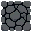
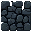
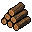
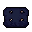
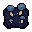
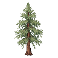

# Goblin Grotto art bible — native pixels and a 32px grid

The owner's required presentation is a fixed three-quarter JRPG view. Every floor,
wall top, wall side and small plant uses a **separate 32×32 RGBA PNG**. Trees
retain their owner-supplied 96×96 canvases and bottom-middle tile anchors. The owner-supplied
goblin has a 32×32 native body, 32×32 static poses and padded 40×40/44×44/48×48 animation canvases. The square
gameplay grid projects to 32×32 screen pixels at the default 1× view. Camera zoom
scales the whole scene uniformly; the tile/body scale remains 32 pixels.

## Layers and anchors

- Floors: top-left at the logical cell's top-left, 32×32.
- Wall tops: their own 32×32 texture, raised one tile (32 pixels) above the cell.
- Wall sides: their own 32×32 texture, at the cell origin. Render the front face
  where a discovered open cell lies to the south; adjacent solid tiles join at
  their tops. Tops and sides use independent sprites, opacity and textures.
- Goblins: original owner-supplied PNGs, never resized or trimmed. Idle foot anchor
  is (16,30). Every animation foot anchor is (width/2, (height−32)/2+30). Both are placed
  at the cell centre and logical foot offset 28, retaining the same body scale.
- Plants: untrimmed 32×32 transparent canvases at the cell origin. Separate tree,
  edible mushroom, grove, undergrowth and young/ripe mushroom-patch images.

Depth follows logical feet with stable column ties. Reveal walls changes opacity
and inspection priority, never world solidity or navigation. Unknown tiles and
plants stay hidden. Source art uses native integer pixels; render interpolation moves the sprite without changing its scale. Use nearest-neighbour
sampling; no per-sprite stretching, smoothing, atlas trimming or automatic cropping.

## Files and reproduction

`public/assets/prototype/manifest.json` lists 29 individual sprites and their native
dimensions. Six terrain families each have a floor, wall-top and wall-side image;
grass, four legacy placeholder goblins and six plant images complete the set. The
live game loads the supplied base instead of those four placeholder textures.

Run `node tools/generate-pixel-art.mjs` to reproduce the original pixel art. No
external game images, fonts or audio were imported. Source art and generated
creative assets follow ASSETS-LICENSE.md; the manifest records their origin.

The art preview is served at `/art-preview.html`, showing
all separate tiles at 3×. See [preview screenshot](screenshots/art-preview.png) and
[in-game reference](screenshots/prototype.png).

Validation: terrain/plant files must decode at 32×32; supplied goblin frames must
retain their manifest dimensions and hashes. All preserve alpha and use
nearest sampling. Tests verify file dimensions and browser decoding, projection,
picking, wall reveal, painting and camera controls. Keep floor edges aligned with
the grid at native size.

The original prototype references remain available for missing asset families.
The native owner-supplied set below defines the current art bible; packed atlas
work remains GG-023.
Landmark props still use original code-drawn markers in `src/render/features.ts`.

## Owner-supplied cardinal goblins

The owner now requests **four cardinal directions**: south, east, north and west.
Grid navigation already uses four neighbours. Work-facing chooses the dominant
axis; vertical wins a tie. Diagonal poses remain legacy references and are not
loaded. Do not mirror a cardinal clip to invent another direction.

Base/hauling ZIPs are pinned to owner commit `37ad2ad`; pick ZIP to `890b554` and latest axe ZIP to `8c96e74`.
The importer reads unchanged copies in `public/assets/goblin/archive/` and copies
327 original PNGs. The manifest records archive/member hashes, dimensions, foot
anchors, per-direction frame counts and curated contact frames. Base west walking
uses `west-6b9bf452`; other takes stay archived.

Idle and walking frames last two 10 Hz simulation ticks. Sleeping uses a static
pose; carrying selects loaded sprites. Normal delivery releases on frame 5 and
finishes on tick 18; interrupted delivery frees cargo immediately (ADR 0005).
Pick Mining and Axe Attack are curated for mining and tree chopping, per the
owner's instruction; this adds no combat. Tool frames remain in source order but
are sampled across an 18-tick cycle so their directional contact aligns with tick
10. The north chop has nine frames; other swings have eight. Each impact applies
18 work once, independent of renderer calls (ADR 0008). Missing east/west axe idle cycles
use the supplied static poses; pick approach uses the base walk because no
pick walking clip exists. Neither fallback invents or mirrors art.

Pause, dialogs and hidden tabs freeze every clip. Swing/drop timelines live in
simulation saves; renderer interpolation changes only displayed position.

The padded canvases are margins, not larger goblins. Never shrink a 48×48 frame
into 32×32, trim its canvas, move its foot anchor independently or stretch it.
Feet use (width/2, (height−32)/2+30), with nearest sampling at scale 1. Sprite
selection and depth use displayed positions.

`/goblin-preview.html` shows all 40 directional clips at 3× with pause and frame controls.
See [cardinal gallery](screenshots/cardinal-animations.png),
[mining/chopping](screenshots/mining-chopping.png), [hauling](screenshots/hauling.png) and [drop](screenshots/drop.png).

## Prepared terrain, item and foliage source sprites

The owner’s 21 exports from commit `81b42da` are extracted alongside their ZIPs
under `public/assets/floors/`, `walls/`, `items/` and `foliage/`. This prepares
185 source PNGs with documented names and provenance, now used by the runtime. See the [inventory and naming convention](../public/assets/README.md)
and [source catalog](../public/assets/sprite-catalog.json).

Use lowercase kebab-case filenames with a two-digit, one-based variant suffix:
`floor-bedrock-01.png`, `wall-rough-stone-01.png`, `item-wood-01.png`,
`lanterncap-farm-01.png`, `tree-silver-birch-01.png`. Keep the owner's existing
family directories. Numbers represent source alternatives, not animation frames,
rotation, growth or quantity. Runtime stage/role mappings are explicit below.

All 176 non-tree images retain 32×32 canvases; all nine tree source images retain
96×96 canvases. The larger tree canvases preserve the 32px tile grid and body scale. Their
bottom-middle 32×32 square is the logical root tile. Preserve all original PNG bytes, alpha and padding;
never automatically resize or crop these sources to fit the prototype renderer.

Reproduce with `python tools/extract-scenery.py`; validate with `--check`.
The catalog records exact original member paths, IDs, dimensions and SHA-256s.
Every family includes unchanged `source-metadata.json`; embedded original paths
refer to its ZIP, while the catalog provides the extracted file paths. Original
ZIPs remain in place. Creative rights follow ASSETS-LICENSE.md.

## Runtime roles and references

The fixed three-quarter JRPG view keeps horizontal surfaces square. Exposed wall
faces sit at the cell origin; tops rise 32px. Use restrained upper-left lighting,
dark one-pixel outlines around major forms, clear silhouettes and crisp integer
pixel clusters. Avoid adding a black border around repeating floor tiles.

| Logical material / role | Floor or top | Exposed face |
| --- | --- | --- |
| Sand | `floors/sandOverlay/floor-sand-overlay-*` | `walls/sand/wall-sand-*` |
| Loose rock | `floors/roughstone/floor-rough-stone-*` | `walls/roughstone/wall-rough-stone-*` |
| Hard stone | `floors/smoothstone/floor-smooth-stone-*` | `walls/smoothstone/wall-smooth-stone-*` |
| Bedrock | `floors/bedrock/floor-bedrock-*` | `walls/bedrock/wall-bedrock-*` |
| Ruin / built wall top | `floors/dwarvenstone/floor-dwarven-stone-*` | Built walls use smooth-stone faces |
| Mud / grass / impenetrable boundary | Existing prototype references where no corresponding export exists | Mud uses supplied mud faces; boundary keeps its reference |

The runtime resolves role IDs from `src/render/scenery.ts`; all originals remain
separate textures. The 185-entry catalog resolves files and native dimensions.
Replacing a curated asset keeps its semantic role/ID stable and requires updating
its source catalog/hash intentionally. A packed atlas is still GG-023.

Actual native reference sprites:

| Floor | Wall face | Resource pile | Young farm | Mature farm | Native tree |
| --- | --- | --- | --- | --- | --- |
|  |  |  |  |  |  |

Palette reference sampled from these original PNGs: rock `#5b5d62`, cool stone
`#57605f`, outline/shadow `#02050b`, foliage midtone `#5b6b45`, leaf highlight
`#a4b383`, lanterncap soil/shadow `#1d223d`. These are family references, not a
mandatory recolour operation; preserve supplied palettes. New art should match
its family in contrast, outline weight and upper-left light direction. Items
use native 32×32 transparent canvases and appear as piles/baskets at the cell
origin; their variant number does not claim a quantity. Interface icons should
stay readable at 32px, with nearest sampling when enlarged. Bed kits keep their
small reference marker until an original craft-item sprite is supplied.

## Tree placement, canopy selection and growth

A 96×96 tree stays at scale 1. Its source square `(32,64)` to `(64,96)` exactly
covers the root tile. For tile `(x,y)`, image top-left is `(32x−32,32y−64)`.
Equivalently, image point `(48,64)` anchors to the root tile's top centre. Logical
feet are at `(48,92)`, matching the actor foot offset 28 within the root tile.
Depth uses the root's logical feet, never the canopy's upper-left corner.

The 3×3 canopy rectangle is the stable inspection/gather hit region. A canopy
click resolves to its one root tile; gathering still uses adjacent cardinal work.
Overlapping objects use logical depth; Reveal walls lets you select goblins
behind trees and fades trees to 25%. Selecting a goblin also fades foreground
canopies intersecting its silhouette. Undiscovered roots hide the whole tree;
chopping it removes the canopy. Tree art adds no extra walkability footprint.

Lanterncap farm art has **three stages with two alternatives each**, curated from
the visible images rather than assuming consecutive filename pairs:

| Stage | Growth ticks | Sprite variants |
| --- | --- | --- |
| Young | 0–199 | `lanterncap-farm-01`, `lanterncap-farm-04` |
| Growing | 200–599 | `lanterncap-farm-03`, `lanterncap-farm-05` |
| Mature / harvestable | 600 | `lanterncap-farm-02`, `lanterncap-farm-06` |

A plot keeps its first/second alternative through all stages and after harvesting.
Wild lanterncaps use wild sprites; harvested food uses picked baskets. Decorative
undergrowth varies between undergrowth, logconks and redcaps without introducing
new harvesting rules. Ore-family sprites represent mixed/iron/copper/gold piles;
the inspector retains the precise resource identity. Ground items hide while held
or represented by a goblin's put-down animation, avoiding duplicate cargo art.

## Export and validation checklist

- Export separate RGBA PNGs with original transparency, full canvas and integer
  dimensions; preserve original ZIPs, metadata, filenames and hashes via the catalog.
- Ground tiles, wall parts, small plants and item canvases stay 32×32. Trees stay
  96×96 with the root square above. Goblin padded animation canvases and foot
  anchors follow the cardinal section; never rescale bodies to fit a canvas.
- Use nearest sampling at native scale 1. No automatic trimming, mirroring,
  interpolation of pixels, smoothing or per-sprite stretching.
- Goblin directions are south/east/north/west. Idle/walk/drop timing and curated
  tool contacts are simulation-tick driven as documented in ADRs 0005 and 0008.
- Run `python tools/extract-scenery.py --check` to verify all 185 originals and
  catalog entries; the goblin hash tests verify animation sources separately.
- Run `npm test` for role resolution, every source alternative, stage pairs,
  deterministic selection, root alignment, depth/picking and save continuation.
- Run browser checks for all loaded native textures, 96px trees at scale 1,
  canopy/root selection, reveal, fog, chopping removal, farm stages, item identity,
  camera/zoom and save/load. Inspect the supplied reference sprites and
  [in-game evidence](screenshots/scenery-integration.png). No missing role may
  silently substitute a different material or consume simulation randomness.

Supplied terrain PNGs have transparent gaps, especially the sparse sand overlays.
Native reference tiles provide solid backing beneath ground, tops and faces,
preserving source alpha and a continuous surface. Wall reveal hides these
backings while fading the supplied face/top.

## Wall perspective lighting

Renderer-only native-resolution gradients add a restrained upper-face highlight, tapering to
shade at the foot. Exposed wall tops retain a dark textured front lip and fade to
pure black towards the back/north edge. Interior top tiles join the black roof.
The lighting uses each wall's same 32px geometry, never repaints or rescales source
PNGs, and is cached with the tile's props. Reveal/selected-actor fade removes the
lighting and solid backings while leaving supplied textures translucent, so the
black roof cannot keep hiding the goblin. Excavation clears the cached wall props.

The wall lighting reuses two 32-step nearest-sampled gradient textures; each
exposed wall adds two simple rectangles to its cached props, avoiding per-row
geometry or per-wall gradient allocation.

Scenery updates/rendering are limited to the camera region, retaining a margin
for tree roots whose 96px canopies extend into view. A regression checks all
intersecting canopies at map edges and multiple zoom levels.
